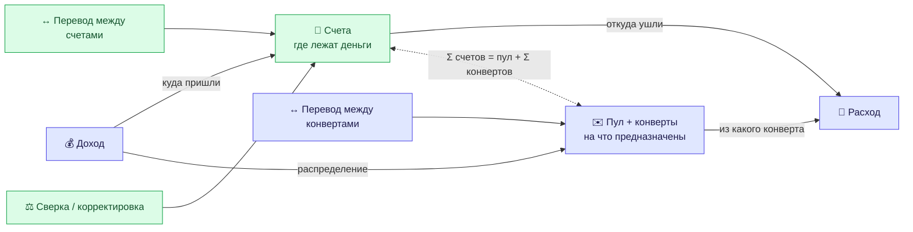

# 🏦 Счета: проработка функционала

_Черновик к обсуждению, 2026-11-20. Решения не приняты — после согласования оформить ADR-004._

> **📌 Кратко**
>
> Счёт отвечает на вопрос «**где** лежат деньги», конверт — «**на что** они предназначены». Это две независимые оси; сейчас в Coffer есть только вторая. Их связывает одно правило: `Σ счетов = свободный пул + Σ конвертов` — оно ловит ошибки ручного ввода, и ради него счета вводятся. Блокер: остаток конверта с политикой `RESET` сейчас исчезает из бюджета, хотя на карте он остаётся, и правило будет ломаться каждый месяц.

## 🧭 Зачем счета, если есть конверты

Сейчас бюджет — величина, оторванная от реальности: доход − распределение − расходы. Забытую покупку на 800 ₽ Coffer не заметит никогда. Счета дают опору:

| Без счетов (сейчас) | Со счетами |
|:--|:--|
| Забытая трата незаметно копится | Сверка с банком показывает расхождение 800 ₽ |
| Непонятно, на какой карте деньги на отпуск | Видно: накопления — на вкладе, повседневное — на дебетовой |
| Кредитку не отразить: покупка в долг выглядит как обычная трата | Долг по карте виден отдельно |
| Импорт выписки некуда привязать | Выписка → счёт, дедупликация по счёту + дате + сумме |
| Банковской синхронизации некуда класть данные | Подключение банка = привязка к счёту Coffer |

## 🗺️ Две оси



Легенда: 🟩 новое · 🟦 есть сейчас. Перевод между счетами **не трогает** конверты, перевод между конвертами **не трогает** счета — это надо явно проговорить в UI.

## 🧱 Модель данных

```prisma
enum AccountType { CASH  DEBIT  CREDIT  SAVINGS }

model Account {
  id              String      @id @default(uuid())
  user_id         String
  name            String              // «Тинькофф Black», «Наличные»
  type            AccountType
  opening_balance Decimal             // остаток на дату начала учёта
  opened_at       DateTime
  icon / icon_color / position
  archived_at     DateTime?
}

// Перевод между счетами: конверты не трогает
model AccountTransfer { from_account_id, to_account_id, amount, date, period_month }

// Корректировка по итогам сверки
model Reconciliation { account_id, date, bank_balance, adjustment, category_id? }
```

Изменения в существующих моделях:

| Модель | Поле | Правило |
|:--|:--|:--|
| `Expense` | `account_id` | Обязательное: откуда ушли деньги |
| `Income` | `account_id` | Для `EXPECTED` необязательное, заполняется при получении |
| `PlannedExpense` | — | Счёт выбирается при проведении плана, в самом плане не хранится |

> **💡 Остаток считаем, а не храним**
>
> `opening_balance + доходы − расходы ± переводы ± корректировки` — одним `SUM` по индексу. Проекция по образцу `CategoryMonthSnapshot` пока не нужна. `BudgetProjectorService` и `@coffer/planning-core` **не меняются**: счета не участвуют в математике конвертов.

## ⚖️ Правило и сверка

```
Σ остатков счетов  =  свободный пул + Σ closing_balance конвертов (расходные + накопления)
```

Сверка (аналог Reconcile в YNAB):

1. Пользователь вводит остаток по банку: 12 340 ₽.
2. Coffer считает: по нашим данным 12 900 ₽ → расхождение −560 ₽.
3. «Найти операцию» (показать непроверенные) или «Списать в корректировку» — расход из выбранного конверта или из свободного пула.

Отдельно — индикатор в шапке «Бюджета»: «На счетах 84 500 · В бюджете 84 500 ✓», подсвечивается при расхождении. Это самая дешёвая и самая полезная часть функции.

## ⛔ Конфликт с текущей моделью: RESET

> **⛔ Остаток RESET-конверта исчезает**
>
> Конверт с `RESET` (и `TRANSFER_TO_FREE`, который сейчас работает так же) начинает месяц с нуля — `shouldCarryOpeningBalance`, `packages/shared/domain/budgetRebuild.ts:102`. Свободный пул вычитает распределение целиком — `computeFreePoolAvailableForPeriod`, `apps/client/src/entities/budget/lib/periodLedgerTotals.ts:56`. Непотраченный остаток пропадает из бюджета, хотя деньги на карте. Правило будет расходиться ежемесячно на сумму таких остатков.

| Вариант | Суть | Оценка |
|:--|:--|:-:|
| **а.** RESET → остаток в свободный пул | По сути так, как задуман `TRANSFER_TO_FREE` | 🟢 рекомендую |
| **б.** Убрать RESET, оставить CARRY / TRANSFER_TO_FREE | Как в YNAB и Actual: деньги не исчезают никогда | 🟡 |
| **в.** Считать исчезнувший остаток «негласным расходом» | Правило формально сходится, но теряет смысл | 🔴 |

Вариант (а) меняет поведение прогноза (ADR-003 считает распределение по правилам базовым расходом), поэтому решение — через ADR.

## 💳 Кредитная карта

| Подход | Как работает | Плюсы | Минусы | Оценка |
|:--|:--|:--|:--|:-:|
| **A. Счёт с отрицательным остатком** | Покупка уменьшает конверт и остаток карты (−5 000). Погашение — перевод дебетовая → кредитка, конверты не меняются | Просто, правило выполняется само | Не видно, хватает ли денег на погашение | 🟢 v1 |
| **B. Конверт погашения (YNAB)** | При покупке сумма переезжает из «Продуктов» в авто-конверт «Погасить Кредитку», погашение тратит его | Деньги на погашение видны и защищены | Новый тип конверта, авто-переводы, крайние случаи (покупка при пустом конверте = реальный долг) | 🟡 позже |
| C. Кредитка вне бюджета | Учитываем только погашения как расход | Совсем просто | Траты попадают не в те месяцы и конверты | 🔴 |

A не тупиковый: B можно добавить поверх как подсказку.

## 🐷 Накопления и сберегательные счета

Конверт накоплений («Подушка», «Отпуск») обычно физически лежит на вкладе или накопительном счёте.

- **Независимо** (как в YNAB): распределение в конверт и перевод на вклад — два разных действия. Правило выполняется, но действий два.
- **Связь «конверт → счёт по умолчанию»**: при распределении в «Подушку» Coffer предлагает «Перевести 10 000 на Накопительный?» одной галочкой. Похоже на уже существующую подсказку `savingsTransferHint`.

Проценты по вкладу — `Income` с `income_type = interest` на этот счёт; дальше их разносит существующий механизм правил распределения.

## 🔁 Перенос существующих данных

1. Создаём счёт «Основной», проставляем его `account_id` всем старым доходам и расходам.
2. `opening_balance` подбираем так, чтобы правило выполнялось на сегодня.
3. При первом заходе — экран «Разнесите деньги по счетам»: пользователь вводит реальные остатки, разница уходит одной стартовой корректировкой.

История не ломается, расхождения отслеживаются с текущего дня.

## 🖥️ Интерфейс

- **Формы расхода и дохода** — поле «Счёт», по умолчанию последний использованный. Если счёт один, поле скрыто: трения для текущего сценария не прибавится.
- **Список счетов** (боковое меню или вкладка) — остатки, итог, кнопка «Сверить».
- **Перевод между счетами** — отдельное действие рядом с переводом между конвертами.
- **Индикатор правила** в шапке «Бюджета».
- **Закрытие месяца** — `MonthCloseReport` хранит остатки счетов на конец месяца; переводы между счетами в `CLOSED`-месяце отклоняются, как прочие мутации периода.

## 🆚 Как у конкурентов

_По общедоступным сведениям, без свежей проверки сайтов._

| | YNAB | Actual | Goodbudget | Дзен-мани | Monarch |
|:--|:-:|:-:|:-:|:-:|:-:|
| Счета | ✅ | ✅ | ✅ | ✅ (центр всего) | ✅ |
| Сверка с банком | ✅ Reconcile | ✅ | 🟡 вручную | 🟡 корректировка остатка | ⚪ за счёт синхронизации |
| Кредитка | конверт погашения | конверт погашения | как обычный счёт | отрицательный остаток | отрицательный остаток |
| Счета вне бюджета (ипотека, брокерский) | ✅ Tracking | ✅ Off-budget | ❌ | ✅ | ✅ |
| Долги как счета | 🟡 | 🟡 | ✅ | ✅ | 🟡 |

## 🪜 Порядок работ

```mermaid
flowchart LR
  s0["0 · ADR"] --> s1["1 · Фикс RESET"] --> s2["2 · Account + миграция"] --> s3["3 · UI счетов"] --> s4["4 · Переводы + кредитка"] --> s5["5 · Сверка"] -.-> s6["6 · Вне бюджета, долги"]

  classDef must fill:#fee2e2,stroke:#dc2626,color:#7f1d1d
  classDef core fill:#fef9c3,stroke:#ca8a04,color:#713f12
  classDef later fill:#f3f4f6,stroke:#9ca3af,color:#374151
  class s0,s1 must
  class s2,s3,s4,s5 core
  class s6 later
```



Легенда: 🟥 блокер · 🟨 основная работа · ⬜ позже.

| Шаг | Что делаем | Проверка |
|:-:|:--|:--|
| 0 | ADR-004: две оси, правило, решения по RESET и кредитке | ADR принят |
| 1 | Исправить RESET, чтобы остаток не исчезал | Тест в `budgetRebuild`: Σ конвертов + пул = доходы − расходы за любой период |
| 2 | `Account` + `account_id`, миграция в «Основной», остатки на лету | Миграция на копии прод-базы: правило выполняется до и после |
| 3 | UI счетов, поле в формах, индикатор правила | Расход с карты уменьшил остаток карты и конверта на одну сумму |
| 4 | Переводы между счетами + кредитка по подходу A | Покупка с кредитки и погашение → конверт списан один раз, правило выполняется |
| 5 | Сверка с корректировкой | Ввёл банковский остаток → корректировка закрыла разницу → индикатор ✓ |
| 6 | (позже) Счета вне бюджета, чистые активы, долги | — |

## ❓ Решить до старта

- **RESET**: остаток в пул (а) или убрать политику (б)?
- **Кредитка**: начинаем с отрицательного остатка (A)? Насколько это срочно — пользуемся ли кредиткой сами?
- **Счёт в расходе обязателен?** Предлагаю да, со счётом по умолчанию — иначе правило не работает.
- **Связь конверта накоплений со счётом** — сразу или потом?
- **Счета вне бюджета** (вклады, которые не тратим, брокерский) — в первой версии или нет?
